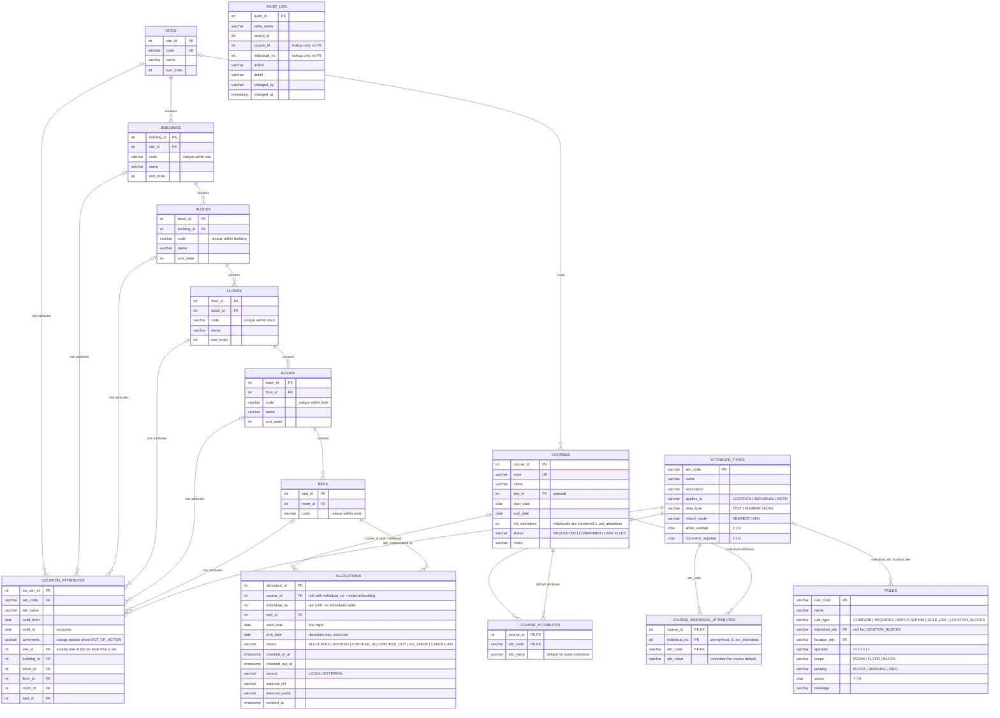

# Accommodation allocation MVP: v2 data model

14 tables in five groups. Structure only; the full definitions, including checks and indexes, are in [`0001_schema.sql`](../src/db/migrations/0001_schema.sql).

| Group | Tables |
|---|---|
| Supply | `SITES` > `BUILDINGS` > `BLOCKS` > `FLOORS` > `ROOMS` > `BEDS`, plus `LOCATION_ATTRIBUTES` |
| Vocabulary and rules | `ATTRIBUTE_TYPES`, `RULES` |
| Demand | `COURSES`, `COURSE_ATTRIBUTES`, `COURSE_INDIVIDUAL_ATTRIBUTES` |
| Allocation | `ALLOCATIONS` |
| Audit | `AUDIT_LOG` (standalone, no relationships) |

## Entity relationship diagram

## Rules the diagram can't show

These are enforced by checks in the schema or by application logic, not by relationships.

- **One level per location attribute.** Each `LOCATION_ATTRIBUTES` row sets exactly one of `site_id`, `building_id`, `block_id`, `floor_id`, `room_id`, `bed_id` (schema check).
- **Course allocation or external booking.** An `ALLOCATIONS` row has both `course_id` and `individual_no`, or neither with `source = EXTERNAL` (schema check).
- **Individuals have no table.** `individual_no` is an anonymous number from 1 to the course's `est_attendees`. It is not a foreign key; the range is checked by application logic.
- **Outages are attributes.** An outage is a location attribute with `attr_code = OUT_OF_ACTION`, value `Y`, and the reason in `comments`. Its attribute type uses `inherit_mode = ANY`, so it applies to every bed below the level it is set on and cannot be overridden.
- **Attribute behaviour.** `allow_overlap` and `comment_required` on `ATTRIBUTE_TYPES` are enforced by application logic.
- **Rule attributes.** `LOCATION_BLOCKS` rules have no `individual_attr`; `COMPARE` and `REQUIRES` need both attributes; `MATCH_WITHIN` and `SOLE_USE` need `individual_attr` (schema check).
- **Dates.** Start is the first night and end is the departure day (exclusive), so two stays overlap when `a.start_date < b.end_date and b.start_date < a.end_date`.
- **Warnings are not stored.** Conflicts and warnings are computed by queries each time; there is no table for them in the MVP.
